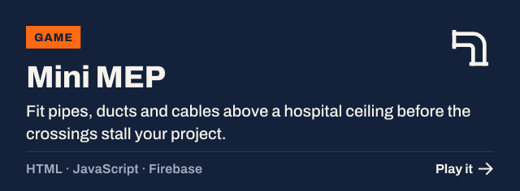
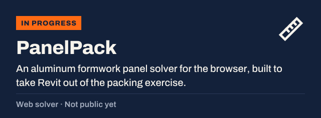
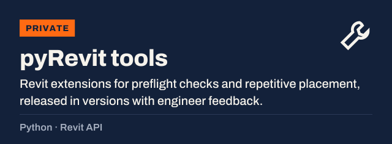

  

I trained as a civil engineer, started out modeling in BIM, and now build the tools I used to wish I had.

Most of my work sits where BIM meets software: Revit automation, model validation, reporting, and getting AI into day-to-day engineering. The question I care about has moved from "how do I automate this task?" to "how do I deploy this to hundreds of users?"

I post about BIM in Malaysia as **Buruh Hybrid**, and I teach kids Scratch and micro:bit robotics part-time.

## What I've built

  
  
  
  

## What I work with

  

  
  
  
  
  
  
  

## What I'm learning

  

C# and Revit add-ins first, then Azure and ASP.NET. I'm also exploring Microsoft Fabric and BIM 2.0 tools like Speckle, Hypar and Motif, and building a micro:bit digital twin in the APS Viewer.

## Find me

  
  
  
  

